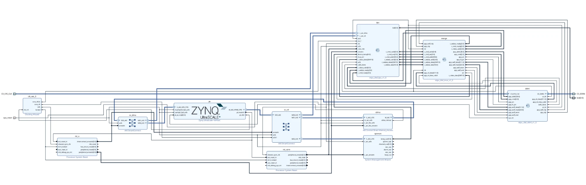
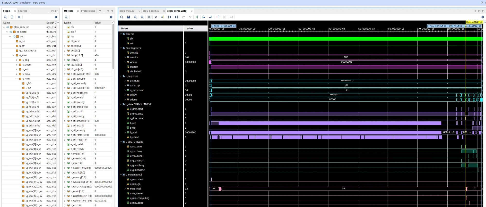
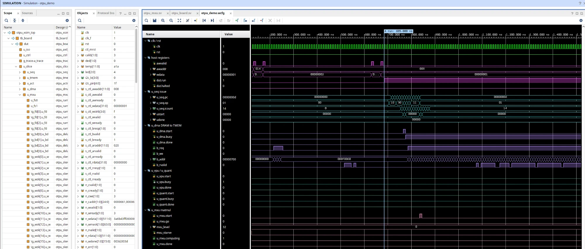

# openTPU on AMD ZCU104

A port of [openTPU](https://github.com/FeSens/openTPU), the open-source AI accelerator by
Felipe Sens Bonetto, to AMD's ZCU104 evaluation board (Zynq UltraScale+ XCZU7EV), built in
Vivado 2025.2.

This repository holds only the port. It is an overlay on openTPU commit
[91df4109](https://github.com/FeSens/openTPU/commit/91df4109): 27 new files, 3 screenshots and 4
changed openTPU files, each changed file marked on its first line. It is an independent port, not made,
reviewed or endorsed by the openTPU authors.

## What the port changes

- **Memory bandwidth.** openTPU's card feeds the core from two DDR3-1066 channels, 17.1 GB/s
  peak, and the core's 128-byte port at 133.33 MHz needs the same. The ZCU104's one DDR4-2133
  SODIMM also peaks at about 17.1 GB/s. A merge (`rtl/boards/zcu104/otpu_mig_mux.sv`) puts the
  core's two memory channels onto the one DDR4 controller.
- **On-chip memory.** The XCZU7EV has about a third of the card's block RAM. The activation RAM
  and the trace buffer go into 68 UltraRAM blocks by constraint
  (`boards/zcu104/vivado/act_uram.xdc`). The RTL is unchanged.
- **Block design.** The accelerator, the merge and the DDR4 controller are RTL module references
  (`rtl/boards/zcu104/otpu_zbd_*.v`) beside the Zynq UltraScale+ processing system, two AXI
  SmartConnects, an AXI Central DMA, the System Management Wizard and the clocking and reset
  blocks. The DDR4 IP's own block design cell is AXI-only, and the merge needs its native
  interface, so the controller comes in as a module reference too.
- openTPU's accelerator logic is used unchanged.



*The block design: `tpu`, `merge` and `ddr4` (RTL module references) beside the Zynq UltraScale+
processing system, the AXI SmartConnects `sc_ctl` and `sc_dma`, the AXI Central DMA, the System
Management Wizard, the Clocking Wizard and two Processor System Resets.*

## Results (Vivado 2025.2, xczu7ev-ffvc1156-2-e)

| Item | Value |
|---|---|
| Timing | all constraints met; core clock 133.33 MHz, worst slack +0.085 ns |
| Worst path | inside the accelerator, 92% routing |
| DSP48E2 | 730 of 1,728 |
| UltraRAM | 68 of 96 |
| CLB LUTs | 142,628 of 230,400 (62%) |

A later build on the final sources, with every block design cell synthesized out of context,
met timing with +0.093 ns on the core clock. Details and the reports reviewed:
[docs/zcu104.md](docs/zcu104.md).

## Simulation

- `tests/test_zcu104.py` runs openTPU's demo programs on its board testbench through the ZCU104's
  memory path (the merge and a DDR4 controller model with random stalls) and checks the results
  against openTPU's ISA simulator. It needs Verilator 5.047 or later.
- In Vivado XSim, the demo ran to halt in 9,083 cycles, and the memory read back matched
  openTPU's reference run byte for byte (3,932,160 bytes compared). XSim compiles the RTL with
  `SYNTHESIS` defined, which removes the RTL's simulation-only zero initializers, so registers
  with no reset start as X. The run needs those registers set to 0 at 1 ps, as the FPGA's INIT
  does. Without that, the run never halts: with the reset pulse on (`TB_CTL_MRST`), two arbiter
  grants in the scratchpad memory stay X and the run stops at about 85 us. See docs/zcu104.md
  section 5.



*The whole demo in Vivado XSim, unknown registers set to 0 at 1 ps. A: the host sets run (685 ns).
B: the matrix unit's first compute cycle (86,195 ns, at the yellow cursor; C's label covers B's).
C: halted (91,515 ns). Most of A to B is `u_dma` clearing 256 KiB of scratchpad. In the Objects
pane, `ctl_mrst` is 0: the reset the testbench ties off.*



*About 0.1 to 1.5 us: the host's last register writes, `run` going high, the sequencer issuing the
14 instructions and `u_dma` starting to read the memory model.*

## Use

```
git clone https://github.com/taitashaw/opentpu
git clone https://github.com/FeSens/openTPU zcu104-build
cd zcu104-build && git checkout 91df4109
git -C ../opentpu archive HEAD -- . ':!README.md' | tar -x
boards/zcu104/run_vivado.sh        # project, synthesis, implementation, bitstream
python3 -m pytest tests/test_zcu104.py
```

Output goes to `build/zcu104/`: `otpu.bit`, `otpu.bin`, `otpu_zcu104.xsa` and
`reports/SUMMARY.txt`.

## Limits

- Not run on a board. The software on the Arm side (host runtime and DMA driver) is not written.
- Random 0 or 1 power-up values for the registers with no reset are not tested.

## Licence

Apache License 2.0, as openTPU. See [LICENSE](LICENSE) and [NOTICE](NOTICE).
